# 图形说明与阅读方法

以下十一张图均由 `python -m src.demo` 自动生成，并按照报告使用优先级排列：先解释产品结构、估值和投资者风险，再展示敏感性与历史依据，最后说明模拟方法。所有带 **Q** 的概率和分布都来自风险中性模型，仅用于估值和情景比较，不代表现实世界预测。

**优先级 A｜核心结构、估值与投资风险（建议放入报告正文）**

## 1 `maturity_redemption_map.svg` — 到期本金状态图

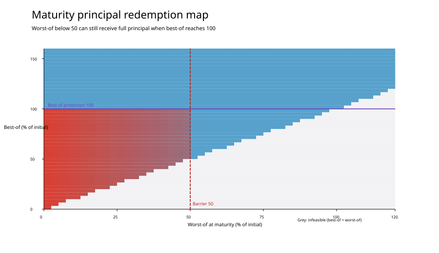

**图中内容：**

- 横轴为到期 Worst-of 相对初始价格的百分比；
- 纵轴为到期 Best-of 相对初始价格的百分比；
- Worst-of 低于约 50% 的竖线表示本金障碍；
- Best-of 达到 100% 的横线表示 Best-of 本金保护；
- 颜色表示到期本金偿还比例；
- 灰色区域表示数学上不可能出现的组合，因为 Best-of 不可能低于 Worst-of。

**如何阅读：**

当 Worst-of 不低于 50%，或 Best-of 不低于 100% 时，本金均为 USD 1,000。只有左下方“Worst-of 跌破 50%且 Best-of 未达到 100%”的区域才按 Worst-of 跌幅承担本金损失。这张图直接解释了取消 Best-of 保护为什么会显著降低估值。

## 2 `monte_carlo_value_distribution.svg` — 折现路径价值分布

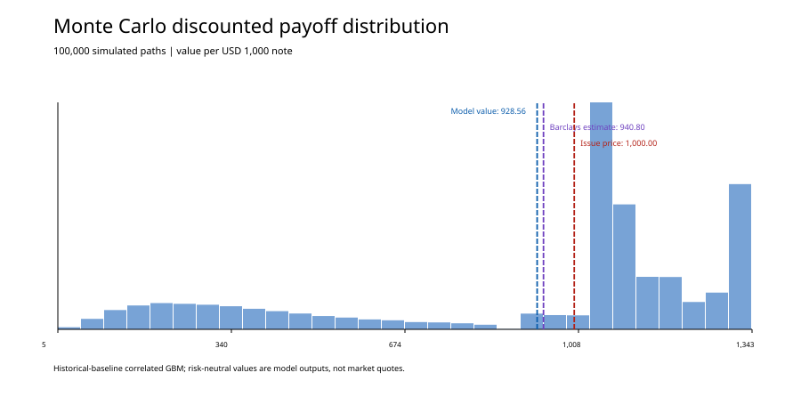

**图中内容：**

- 横轴为每条路径全部现金流的定价日折现价值；
- 柱高为落入该价值区间的模拟路径数量；
- 三条竖线分别表示模型价值 USD 928.56、Barclays 初始估计价值 USD 940.80 和发行价 USD 1,000。

**如何阅读：**

模型价值是整张分布的均值，而不是最常见的单一路径结果。分布的多个集中区域来自不同赎回时间、累计票息和到期本金状态。该图适合比较“模型估值”“发行人披露估值”和“投资者支付价格”，但不能单独说明现实世界亏损概率。

## 3 `nominal_return_distribution.svg` — 名义总回报分布

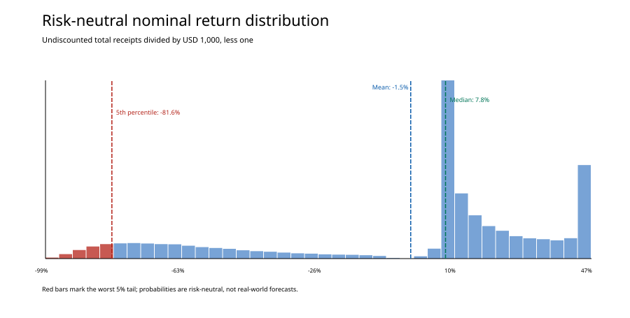

**图中内容：**

名义总回报定义为：

\[
R^{nominal}=\frac{\text{未折现票息与本金总收入}}{1{,}000}-1.
\]

- 蓝色柱表示一般路径；
- 红色柱标记最差 5% 尾部；
- 竖线表示均值、中位数和第 5 百分位数。

**如何阅读：**

基准结果的中位回报为正，而平均回报为负，说明分布具有明显左尾：多数普通状态可获得票息，但少数严重 Worst-of 本金损失会拉低均值。该图没有考虑资金时间价值；估值分析应结合折现价值分布，而投资损失结构则可结合本图观察。

## 4 `exit_distribution.svg` — 退出时间分布

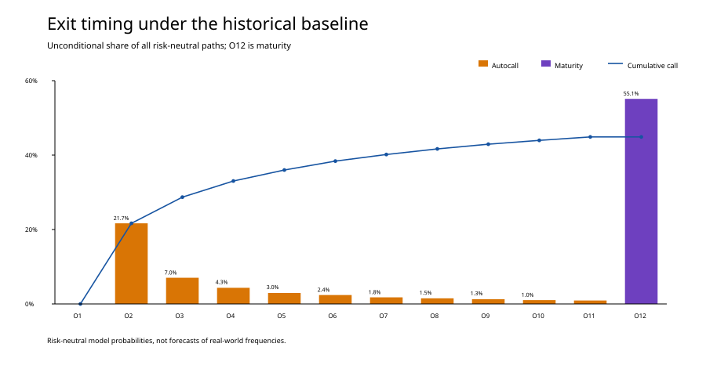

**图中内容：**

- 橙色柱表示各期自动赎回的无条件风险中性比例；
- 紫色柱表示到期退出比例，因此只在 O12 出现；
- 蓝线表示截至各期的累计自动赎回比例；
- 所有柱子的分母都是最初的 100,000 条路径，而不是当期仍存续的路径。

**如何阅读：**

O1 不允许自动赎回，因此第一期赎回比例为零。基准模型下约 44.89% 的路径在 O2–O11 提前结束，其余约 55.12% 存续至 O12。该图可以帮助分析平均期限和再投资风险，但这些比例仍然是风险中性模型输出。

## 5 `coupon_distribution.svg` — 累计票息分布

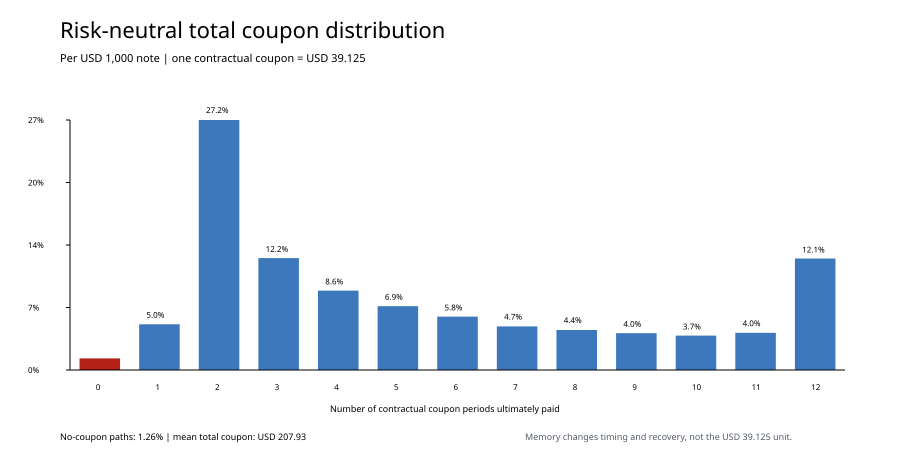

**图中内容：**

- 横轴为一条路径最终实际支付的合同票息期数，0 至 12 期；
- 每一期对应 USD 39.125，因此横轴数值乘以 USD 39.125 即为累计票息；
- 纵轴为历史基准风险中性模型下的路径比例；
- 红色柱表示整个生命周期没有收到任何票息的路径；
- 图下注明零票息路径比例和平均累计票息。

**如何阅读：**

票息期数既受每个观察日的三股票障碍条件影响，也受自动赎回时间影响。较早自动赎回的路径即使表现良好，也只能获得较少期数的票息；长期存续且后续恢复的路径可能通过 Memory 一次补发多期。Memory 改变票息支付时间和恢复机会，但每一期合同票息仍是 USD 39.125。图中的比例是风险中性模型输出，不能直接表述为投资者现实中收到相应票息的预测概率。

**优先级 B｜敏感性、历史表现与参数依据（正文或重点附录）**

## 6 `scenario_sensitivity.svg` — 模型价值敏感性

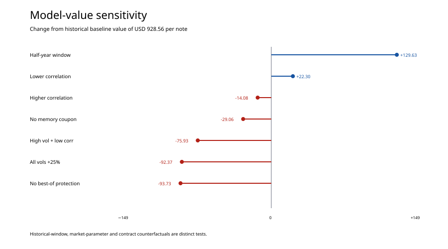

**图中内容：**

- 中央零点代表历史基准价值 USD 928.56；
- 每个点表示某情景相对基准的美元价值变化；
- 蓝色表示估值上升，红色表示估值下降。

**如何阅读：**

半年窗口使价值上升约 USD 129.63，主要因为该窗口估计的波动率和相关性整体不同；全部波动率增加 25% 使价值下降约 USD 92.37；取消 Best-of 保护使价值下降约 USD 93.73；取消 Memory coupon 也会降低投资者价值。由于使用共同随机数，这些差异受 Monte Carlo 噪声的干扰较小。

## 7 `normalized_prices.svg` — 历史标的表现

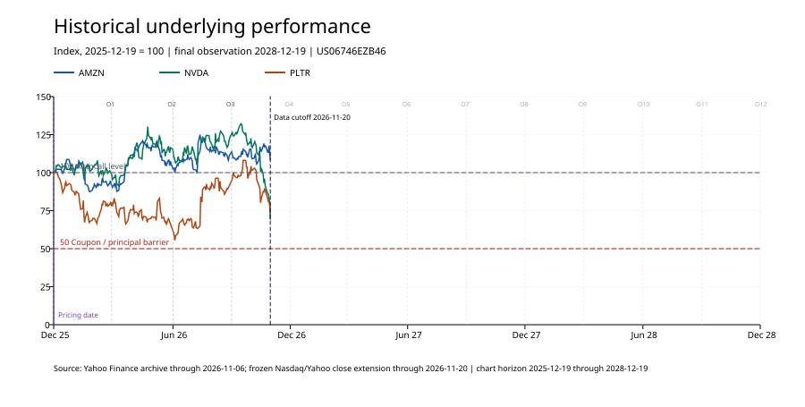

**图中内容：**

- 三条实线分别表示 AMZN、NVDA 和 PLTR 的实际 Close；
- 每只股票都除以自己的合同初始价格，并令定价日等于 100，因此纵轴不是美元价格；
- 100 水平线是自动赎回门槛；
- 约 50 的水平线是票息和本金障碍；
- O1–O12 表示合同观察日；
- Pricing date 竖线表示合同定价日，Data cutoff 表示当前真实数据终点；
- 数据终点之后保留空白横轴至 2028 年最后观察日，便于与模拟图使用相同时间范围。

图中发行日校准档案来自 Yahoo Finance 冻结响应并截至 2026-11-06；11月9日至11月20日的十个交易日来自单独保存并校验的 Nasdaq/Yahoo 当前 Close 快照。该增量只用于合同回放和展示，不改变发行日估值参数。

**如何阅读：**

在某个已发生观察日，三条线必须同时位于 50 以上才支付当期票息；从 O2 开始，三条线必须同时位于 100 以上才自动赎回。截至 2026-11-20，完成的观察日仍为 O1–O3；11月20日并非观察日，所以图末价格只反映持有期状态，不产生新的合同现金流。图中只展示实际历史情况，不用于未来预测或重新校准定价日模型。

## 8 `parameter_window_comparison.svg` — 历史窗口敏感性

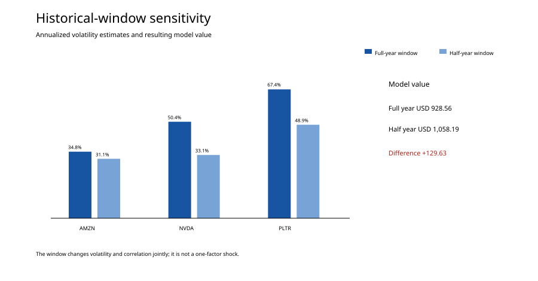

**图中内容：**

- 每只股票的两根柱分别为一年窗口和半年窗口的年化波动率；
- 右侧列出两个窗口对应的模型价值和差额。

**如何阅读：**

半年窗口的三只股票波动率均低于一年窗口，因此得到更高的模型价值。但窗口切换也同时改变了相关矩阵，所以价值差异不能全部归因于波动率。这张图用于展示参数估计风险：即使合同条款不变，选取不同历史样本也可能显著改变估值。

## 9 `correlation_heatmap.svg` — 历史相关矩阵比较

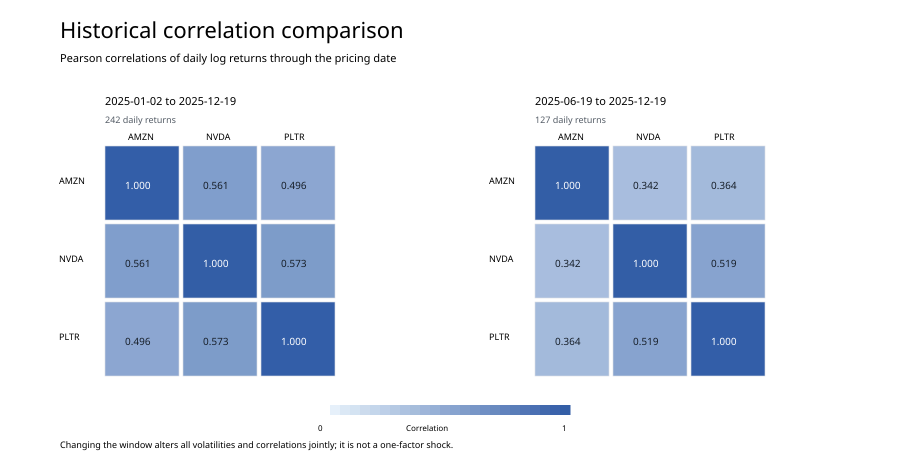

**图中内容：**

- 左侧为 2025-01-02 至 2025-12-19 的一年窗口；
- 右侧为 2025-06-19 至 2025-12-19 的半年窗口；
- 每个单元格显示两只股票日对数收益率的 Pearson 相关系数；
- 对角线恒为 1，颜色越深表示相关性越高。

**如何阅读：**

半年窗口中的三组相关系数整体低于一年窗口。这意味着不同样本窗口不只改变波动率，也会改变三只股票共同涨跌的程度。对于本产品，相关性同时影响三只股票共同达到票息和赎回条件的机会，以及至少一只股票触发 Best-of 本金保护的机会，因此不能简单断言相关性越高或越低一定更安全。这张图应与 `parameter_window_comparison.svg` 一起阅读。

**优先级 C｜路径示例与模型诊断（适合方法部分或附录）**

## 10 `representative_median_path.svg` — 代表性实际模拟路径

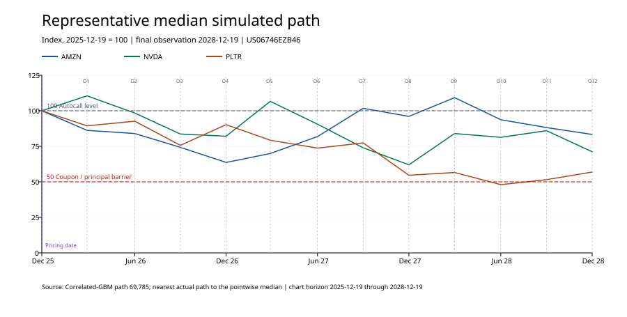

**图中内容：**

- 从 100,000 条完整路径中，选出与“逐观察日、逐标的中位数路径”距离最近的一条真实路径；
- 图形使用与历史图相同的标准化方法、障碍线和观察日；
- 对应逐期现金流保存在 `representative_median_path.csv`。

**如何阅读：**

这张图用于演示一条完整路径如何进入合同现金流引擎。它不是把各期中位数拼接出来的虚构路径，而是模拟中真实存在的一条路径，因此股票走势、票息和最终本金状态彼此一致。代表性不等于最可能，也不等于模型期望值。

## 11 `monte_carlo_paths.svg` — 模拟价格路径样本

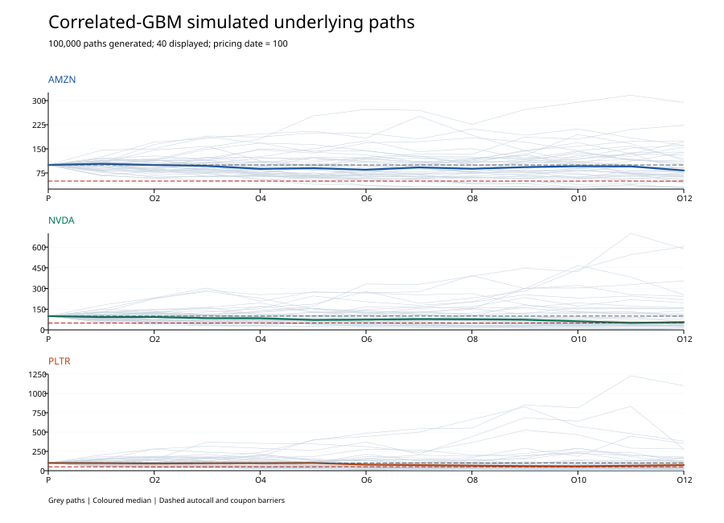

**图中内容：**

- 三个面板分别对应 AMZN、NVDA 和 PLTR；
- 100,000 条路径中抽取 40 条以灰线展示，避免图形过密；
- 彩色粗线是所展示路径在各观察期的横截面中位数；
- 虚线表示自动赎回线和票息障碍线；
- P 为定价日，O1–O12 为观察期。

**如何阅读：**

这张图展示模型产生的价格范围、波动程度和三只股票之间的相对风险。PLTR 波动率最高，因此路径通常最分散。灰线只是模拟样本，不对应真实预测；三个面板中的路径由相关冲击共同生成，不是三组完全独立的模拟。

---

**当前状态、参数换挡与事件压力扩展（由 `python -m src.stress_demo` 生成）**

## 12 `election_regime_comparison.svg` — 近期诊断窗口参数更新

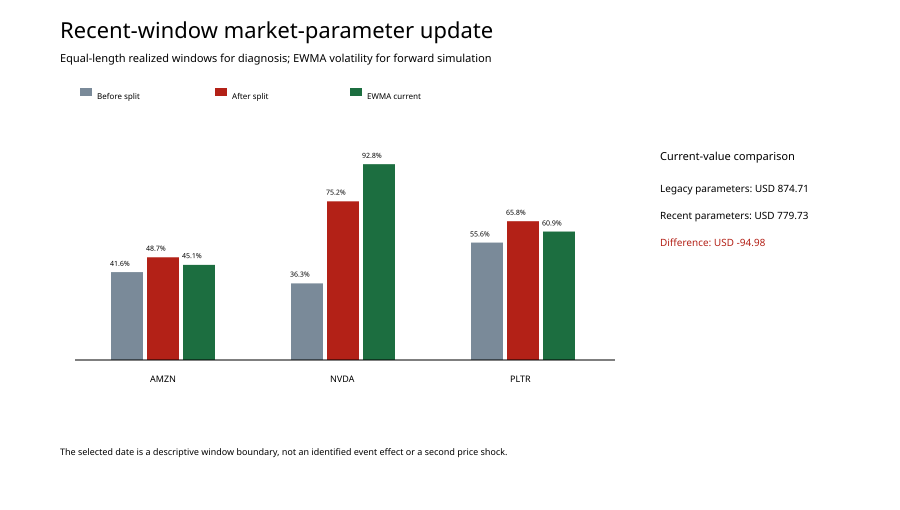

**图中内容：**

- AMZN、NVDA 和 PLTR 在 2026-11-03 前后各 13 个日收益的年化已实现波动率；
- 用于后续模拟的 EWMA 当前波动率；
- 旧参数与近期更新参数下的当前票据价值比较。

**如何阅读：**

该图把 2026-11-03 作为描述性窗口边界，而不是政治事件效应或额外价格冲击。短窗口只用于描述变化方向；模拟参数由全历史 EWMA 更新，近期相关性还向长期矩阵收缩，以降低小样本噪声。

## 13 `spacex_car.svg` — 假设性共同股票冲击的历史幅度参照

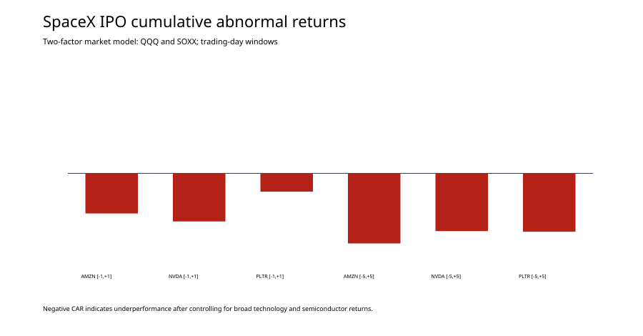

**图中内容：**

- 每只股票分别展示 SpaceX IPO 的 `[-1,+1]` 和 `[-5,+5]` 交易日累计异常收益；
- 正常收益由事件前估计的 QQQ 与 SOXX 两因子市场模型给出；
- 负 CAR 表示股票在控制广义科技市场和半导体板块后仍然表现较弱。

**如何阅读：**

`[-5,+5]` CAR 只用于选择假设性同步股票冲击的幅度。SpaceX 与三只标的并非直接可比公司；单一事件和较小的近似 z 值不能识别因果，也不代表同样冲击未来必然重现。

## 14 `factorial_stress.svg` — 利率与假设性共同股票冲击四情景

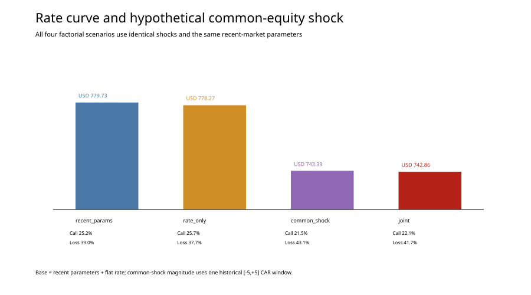

**图中内容：**

- `current_regime`：近期更新参数、发行日平坦利率和当前股票价格；
- `rate_only`：只替换为当前期限利率曲线代理；
- `ipo_only`：只对当前股票价格施加假设性共同股票冲击；代码名为兼容既有输出保留；
- `joint`：同时替换利率曲线并施加代理 CAR；
- 四个情景使用相同 Monte Carlo 随机数以及相同的近期波动率和相关性参数。

**如何阅读：**

四个情景构成 2×2 因子设计，用于比较利率变化、假设性共同股票冲击和两者共同作用。柱形高度为当前估值日的剩余现金流价值，不包括已支付的前三期票息。这里的“影响”是受控模型情景差异，不是现实事件的因果效应。

## 15 `interaction_effect.svg` — 联合非线性效应

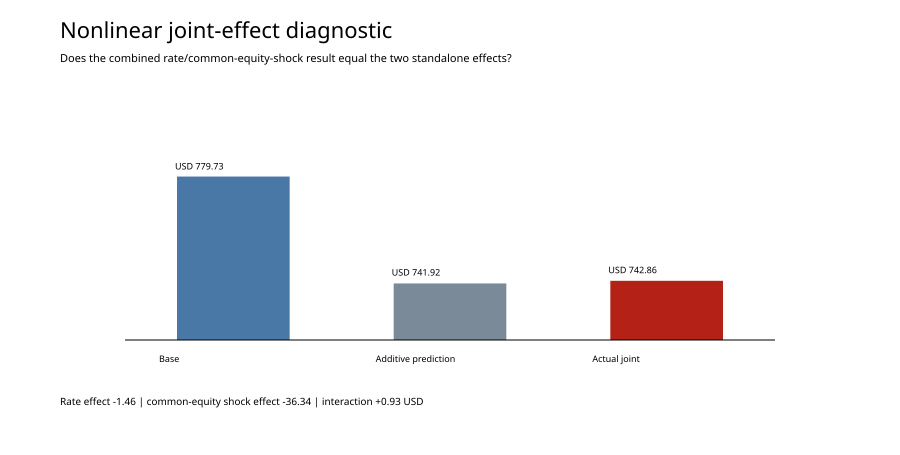

**图中内容：**

- Base 为使用近期更新参数、但不施加两个压力因素的 `current_regime` 当前价值；
- Additive prediction 为把利率单独效应与共同股票冲击效应机械相加后的预测；
- Actual joint 为两项冲击同时进入路径模拟所得的真实联合结果；
- 两者差额为 barrier、autocall 和 memory 机制产生的互动项。

**如何阅读：**

如果 Actual joint 与 Additive prediction 相同，两个因素在该指标上近似可加；若不同，则说明障碍和提前赎回机制使联合结果具有非线性。该互动项使用共同随机数计算，以降低 Monte Carlo 噪声。
