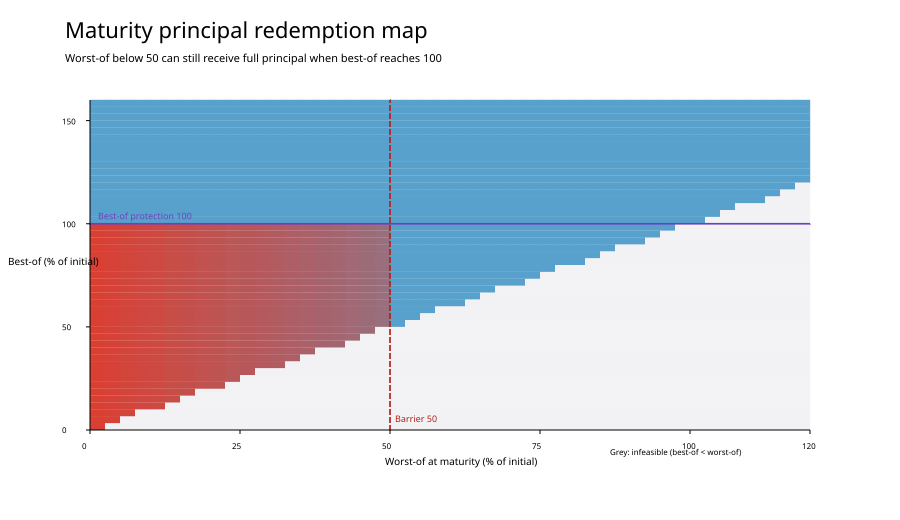
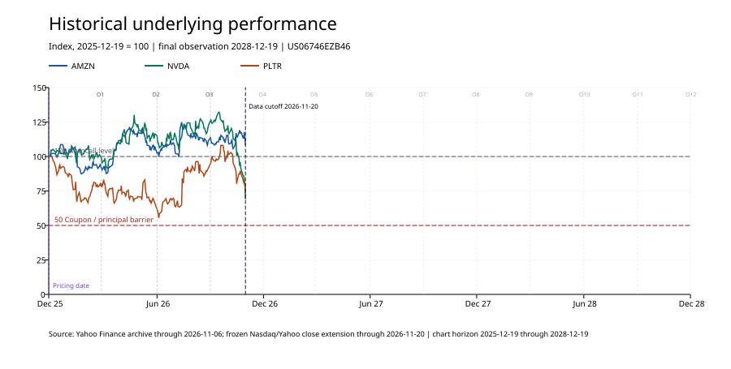
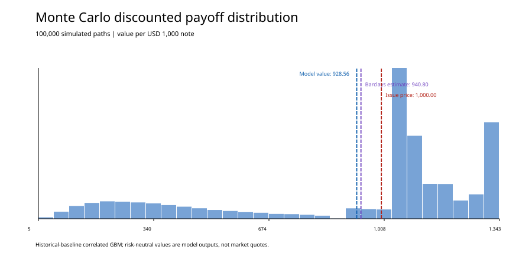
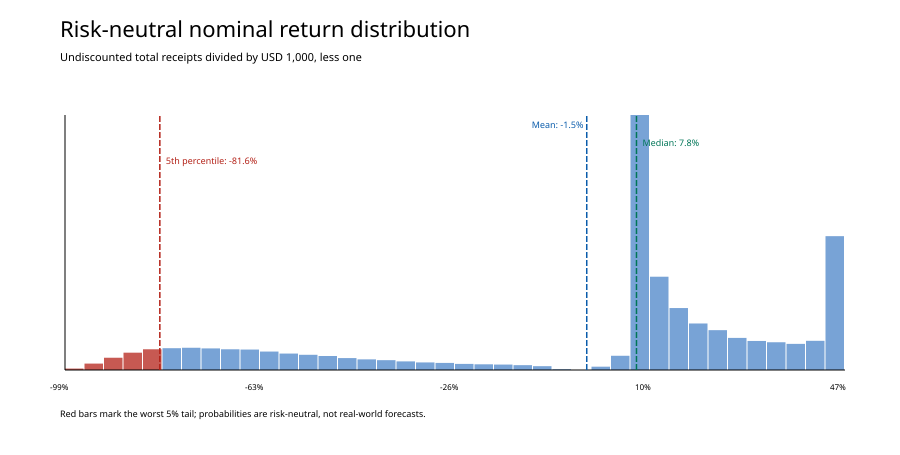

**English** | [中文](README_ZH.md)

# CUHK FTEC5690 Barclays Worst-of Autocallable Memory Note

This repository analyses Barclays Bank PLC's three-stock structured note **US06746EZB46** for the CUHK FTEC5690 group project.

The note has:

- principal amount of USD 1,000 per note;
- Amazon (AMZN), NVIDIA (NVDA), and Palantir (PLTR) as reference stocks;
- a pricing date of 19 December 2025 and a maturity date of 22 December 2028;
- a 15.65% annual contingent coupon, observed quarterly;
- worst-of coupon conditions, coupon memory, quarterly autocall, a maturity principal barrier, and non-standard best-of principal protection.

The contractual terms are taken from the [SEC final pricing supplement](https://www.sec.gov/Archives/edgar/data/312070/000191870425022061/form424b2.htm).

The project converts those terms into reproducible code and combines:

1. frozen market-data validation and historical contract replay;
2. historical volatility and correlation estimation;
3. risk-neutral correlated geometric Brownian motion;
4. pathwise coupon, memory, autocall, and principal cash-flow calculation;
5. Monte Carlo valuation and investor-risk metrics;
6. parameter sensitivity and contractual counterfactuals; and
7. a separate holding-period stress extension using the market state on 20 November 2026.

This is a transparent course model for product analysis. It is not a dealer quote, a real-world probability forecast, or investment advice.

---

## 1 Quick Start

Run the project from the repository root:

```bash
cd "/Users/wener/Documents/CUHK/5690-project"
source .venv/bin/activate
python -m pip install -r requirements.txt
python -m unittest discover -s tests -v
python -m src.demo
python -m src.stress_demo
python -m src.model_robustness
```

`python -m src.demo` validates the issue-date data, replays completed observations, runs the 100,000-path baseline valuation and ten sensitivity or counterfactual scenarios, and regenerates the main CSV and SVG outputs.

`python -m src.stress_demo` runs the separate conditional analysis as of 20 November 2026. It fixes the first three realised observations and studies the remaining cash flows under updated volatility and dependence, the current rate-curve proxy, a hypothetical common-equity shock, and their joint effect.

The repository currently has **33 automated tests** covering contract boundaries, memory coupons, autocall, best-of protection, vectorised and pathwise engine consistency, calibration, correlation matrices, discounting, exit distributions, the rate curve, event-study calculations, recent-regime parameters, current-state valuation, the historical Close extension, and interaction decomposition.

`python -m src.model_robustness` compares Gaussian and Student-t copulas (five degrees of freedom) at the original pricing date. Both models use standard-normal marginal shocks and the same pricing inputs. The group's comparison is saved to [model_robustness.csv](output/tables/model_robustness.csv), including the paired valuation difference and its Monte Carlo standard error.

---

## 2 Product Payoff

### 2.1 Contingent coupon and memory

The quarterly coupon amount is:

$$
1{,}000\times\frac{15.65\%}{4}=\text{USD }39.125.
$$

On each observation date, the coupon is payable only when **all three stocks** close at or above their respective coupon barriers. If the condition fails, the missed coupon is stored in a memory balance. A later successful observation pays the current coupon plus all eligible remembered coupons. Any unrecovered coupons expire when the note terminates.

### 2.2 Autocall

Observation 1 is not callable. From observations 2 to 11, the note is automatically redeemed when all three stocks close at or above 100% of their contractual initial values. The investor then receives:

- USD 1,000 principal;
- the current qualifying coupon; and
- any coupons recovered through the memory feature.

No later note cash flow is generated after an autocall.

### 2.3 Principal at maturity

If the note survives to observation 12, define:

$$
R_{\min}=\min_i\left(\frac{S_{i,T}}{S_{i,0}}\right),\qquad
R_{\max}=\max_i\left(\frac{S_{i,T}}{S_{i,0}}\right).
$$

The maturity principal is:

$$
P_T=
\begin{cases}
1{,}000, & R_{\min}\ge 50\%\ \text{or}\ R_{\max}\ge100\%,\\
1{,}000R_{\min}, & R_{\min}<50\%\ \text{and}\ R_{\max}<100\%.
\end{cases}
$$

Formal calculations use the listed dollar barriers, not an unrounded 50% approximation. The special best-of protection means that full principal can still be repaid when the worst stock breaches its barrier, provided the best-performing stock reaches its initial value.



---

## 3 Repository Structure

```text
5690-project/
├── config/
│   ├── product_terms.yaml       # SEC-defined contract terms and dates
│   ├── market_calendar.yaml     # validated market-session calendar
│   ├── model_inputs.yaml        # issue-date market and numerical inputs
│   ├── event_study.yaml         # event-study dates, windows, and controls
│   └── stress_scenarios.yaml    # holding-period stress assumptions
├── data/
│   ├── raw/                     # frozen Yahoo responses and SHA-256 manifest
│   ├── processed/               # Close, replay Close, Adjusted Close, actions
│   ├── event_study/             # frozen event-window data
│   ├── stress/                  # frozen current-state price data
│   ├── rates/                   # current Treasury curve proxy
│   └── data_dictionary.md       # fields, sources, processing conventions
├── src/
│   ├── data_loader.py           # validation and reproducible data rebuilding
│   ├── payoff.py                # readable single-path contract engine
│   ├── model.py                 # calibration and correlated-GBM simulation
│   ├── valuation.py             # vectorised valuation and risk statistics
│   ├── rates.py                 # rate interpolation, discounting, forwards
│   ├── event_study.py           # two-factor market model and CAR
│   ├── regime.py                # EWMA volatility and shrunk correlation
│   ├── stress.py                # current-state and factorial stress analysis
│   ├── visualization.py         # reproducible SVG figures
│   ├── demo.py                  # issue-date workflow entry point
│   └── stress_demo.py           # holding-period stress entry point
├── tests/                       # unit and cross-engine consistency tests
└── output/
    ├── tables/                  # auditable CSV results
    ├── figures/                 # main report SVG figures
    └── stress/                  # holding-period stress outputs
```

### Main module responsibilities

- `load_market()` verifies the frozen Yahoo archive, market sessions, identifiers, currency, timezone, duplicate or missing observations, prices, corporate actions, and contractual initial levels.
- `extend_close_with_current_snapshot()` validates and appends later common Close observations for contract replay and Figure 1 only. It does not alter pricing-date calibration.
- `evaluate_note()` implements a readable path-by-path contract engine.
- `evaluate_price_array()` is the vectorised engine used for 100,000 paths.
- `calibrate_historical()` estimates annualised volatility and the return correlation matrix.
- `src.demo` orchestrates the issue-date analysis, while `src.stress_demo` keeps the later conditional stress analysis separate.

---

## 4 Data Sources Controls and Look-ahead Prevention

### 4.1 Source hierarchy

| Data object | Main use | Control |
|---|---|---|
| SEC pricing supplement | Terms, dates, barriers, payment rules | Highest-priority source for product terms |
| Frozen Yahoo Chart responses | Historical Close and Adjusted Close | Local raw JSON plus SHA-256 manifest |
| `prices_close.csv` | Main contractual replay archive | Actual Close, no interpolation |
| `prices_close_replay.csv` | Replay and Figure 1 through 20 Nov 2026 | Validated main archive plus later common Close sessions |
| `prices_adjusted.csv` | Return, volatility, and correlation estimation | Adjusted Close is never compared with dollar barriers |
| Corporate-action output | Dividend and split review | A detected split stops automatic replay |
| Frozen Nasdaq/Yahoo current snapshots | Holding-period state and replay extension | Stored separately from the issue-date archive |
| Federal Reserve H.15 | Current curve proxy | Constant-maturity yields treated as a simplified zero curve |

Close is used for contractual observations because payment tests depend on actual closing values. Adjusted Close is used for return statistics because it reduces non-economic jumps caused by distributions or splits.

### 4.2 Look-ahead controls

- Pricing-date parameters use information available through 19 December 2025 only.
- Post-pricing observations are used for contractual replay and holding-period monitoring, not to estimate the issue-date parameters.
- The validated Yahoo archive used for the main quality table remains frozen through 6 November 2026 and contains 464 sessions.
- A separately checksum-verified Close snapshot extends replay and Figure 1 by ten sessions through 20 November 2026.



As of 20 November 2026, the completed contractual observations remained O1 to O3. Each passed the coupon condition, implying cumulative contractual coupons of USD 117.375, and neither O2 nor O3 triggered an autocall. The 20 November closes were AMZN USD 246.82, NVDA USD 125.53, and PLTR USD 143.49, equal to 108.56%, 69.36%, and 74.20% of their initial prices. Because 20 November was not an observation date, these prices did not create a new coupon or redemption cash flow.

---

## 5 Issue-date Model

### 5.1 Historical calibration

Daily log returns are calculated from Adjusted Close:

$$
r_{i,t}=\ln\left(\frac{S^{adj}_{i,t}}{S^{adj}_{i,t-1}}\right),
\qquad
\sigma_i=\operatorname{Std}(r_{i,t})\sqrt{252}.
$$

The baseline window is 2 January to 19 December 2025 and contains 242 daily returns. A half-year window is retained as a parameter-sensitivity case.

| Parameter | AMZN | NVDA | PLTR |
|---|---:|---:|---:|
| Annualised volatility | 34.78% | 50.42% | 67.35% |
| Continuous dividend yield | 0.00% | 0.03% | 0.00% |

| Correlation | AMZN | NVDA | PLTR |
|---|---:|---:|---:|
| AMZN | 1.0000 | 0.5613 | 0.4959 |
| NVDA | 0.5613 | 1.0000 | 0.5730 |
| PLTR | 0.4959 | 0.5730 | 1.0000 |

### 5.2 Risk-neutral correlated GBM

Each stock follows:

$$
\Delta\ln S_i=
\left(r-q_i-\frac{1}{2}\sigma_i^2\right)\Delta t
+\sigma_i\sqrt{\Delta t}\,Z_i,
$$

where the shocks are correlated through the Cholesky factor of the estimated correlation matrix. The issue-date baseline uses:

- a 3.53% continuously compounded constant rate proxy;
- 100,000 paths;
- random seed 5690;
- Actual/365 calendar time between contractual dates; and
- the 12 contractual observation dates as the simulation grid.

Volatility and correlation are historical estimates rather than option-implied surfaces. The output is therefore a reproducible course-model valuation rather than a full trading-desk price.

### 5.3 Cash flows valuation and scenarios

Each simulated path is passed through the coupon, memory, autocall, and maturity branches. Contractual cash flows are placed on payment dates and discounted as:

$$
PV_k=CF_k e^{-rt_k},
\qquad
\widehat V=\frac{1}{N}\sum_{n=1}^{N}PV^{(n)}.
$$

The Monte Carlo standard error measures finite-simulation noise only. It excludes parameter, model, data, liquidity, and contract-interpretation uncertainty.

Ten issue-date scenarios reuse the same random shocks to reduce comparison noise. They include a half-year window, joint volatility and correlation changes, and counterfactual removal of memory or best-of protection.

---

## 6 Baseline Results

| Metric | Result |
|---|---:|
| Model value | USD 928.56 |
| Monte Carlo standard error | USD 1.21 |
| Autocall incidence Q | 44.885% |
| Maturity incidence Q | 55.115% |
| Principal-loss incidence Q | 28.215% |
| Mean cumulative coupon | USD 207.93 |
| Mean nominal total return Q | -1.51% |
| Median nominal total return Q | 7.825% |
| Mean return in the worst 5% of paths Q | -87.34% |
| Mean principal-payment time | 2.084 years |
| At least one memory recovery Q | 26.915% |

Barclays disclosed an initial estimated value of USD 940.80 versus the USD 1,000 public issue price. The group model does not treat the difference as a single fee estimate because financing, hedging, distribution, liquidity, model, and other effects are not separately identified.

All values labelled **Q** come from the risk-neutral valuation distribution. They support pricing and scenario comparison and are not real-world forecasts.





---

## 7 Holding-period Current-state Stress Extension

The separate extension values remaining cash flows as of 20 November 2026, conditional on the note remaining outstanding after O1 to O3. Paid coupons are excluded from current value, and only O4 to O12 are simulated.

### 7.1 Recent parameter replacement

The 3 November 2026 split is used only as a descriptive window boundary. It is not interpreted as a political-event effect or applied as a second spot-price shock.

The code compares equal 13-return windows, updates volatility using EWMA with decay 0.90, and shrinks the recent correlation estimate 30% toward a 70% long-run matrix weight. In the post-boundary window, NVDA returned -39.27% and its annualised realised volatility rose from 36.30% to 75.17%; its EWMA volatility reached 92.78%.

### 7.2 Hypothetical common-equity shock

A two-factor market model using QQQ and SOXX estimates event-window abnormal returns around the SpaceX event. The `[-5,+5]` CAR vector used to scale the hypothetical synchronous shock is AMZN -6.34%, NVDA -5.22%, and PLTR -5.28%.

This is a transparent stress magnitude based on one historical window. It does not establish causality, direct comparability, or a prediction of a future IPO effect. Legacy output names containing `ipo_only` are retained for compatibility; the report interpretation is “hypothetical common-equity shock.”

### 7.3 Comparable scenarios

| Scenario | Parameters | Rate | Common-equity shock |
|---|---|---|---|
| `legacy_current` | Issue-date historical parameters | Flat 3.53% | No |
| `current_regime` | Recent EWMA and shrunk dependence | Flat 3.53% | No |
| `rate_only` | Recent regime | 19 Nov 2026 H.15 proxy curve | No |
| `ipo_only` | Recent regime | Flat 3.53% | Yes; legacy code name |
| `joint` | Recent regime | Current proxy curve | Yes |

| Scenario | Current value | Autocall Q | Next autocall Q | Principal loss Q |
|---|---:|---:|---:|---:|
| `legacy_current` | USD 874.71 | 22.43% | 0.27% | 34.46% |
| `current_regime` | USD 779.73 | 25.18% | 1.62% | 38.98% |
| `rate_only` | USD 778.27 | 25.75% | 1.63% | 37.67% |
| `ipo_only` | USD 743.39 | 21.50% | 0.75% | 43.06% |
| `joint` | USD 742.86 | 22.07% | 0.76% | 41.68% |

Replacing issue-date parameters with the recent regime changes conditional value by -USD 94.98, the largest selected difference. The rate-curve replacement has a net -USD 1.46 effect, while the hypothetical common-equity shock changes value by -USD 36.34 and raises principal-loss incidence from 38.98% to 43.06%.

The interaction is defined as:

$$
I_V=V_{joint}-V_{rate}-V_{shock}+V_{current\ regime}.
$$

Its current estimate is approximately USD +0.93. Non-zero interaction is expected because coupons, autocall, and principal protection contain discrete barriers.

---

## 8 Main Generated Outputs

### Figures

| File | Interpretation |
|---|---|
| `maturity_redemption_map.svg` | Worst-of and best-of maturity principal states |
| `monte_carlo_value_distribution.svg` | Discounted path-value distribution and price references |
| `nominal_return_distribution.svg` | Risk-neutral nominal return and severe left-tail loss |
| `exit_distribution.svg` | Autocall timing and maturity survival |
| `coupon_distribution.svg` | Paid coupon periods and memory effects |
| `scenario_sensitivity.svg` | Issue-date parameter and contract sensitivity |
| `normalized_prices.svg` | Historical Close, barriers, and completed observations |
| `parameter_window_comparison.svg` | One-year versus half-year calibration |
| `correlation_heatmap.svg` | Historical correlation matrices |
| `representative_median_path.svg` | One actual simulated path nearest the pointwise median |
| `monte_carlo_paths.svg` | Correlated-GBM path sample |

### Tables

| File | Interpretation |
|---|---|
| `data_quality.csv` | Data range, missing and duplicate checks, actions, initial levels |
| `historical_replay.csv` | Completed observations and contractual cash flows |
| `parameters.csv` | Historical-window volatility and correlation estimates |
| `monte_carlo_summary.csv` | Baseline value and risk metrics |
| `scenarios.csv` | Ten issue-date scenarios and counterfactuals |
| `exit_distribution.csv` | Exit incidence by scenario and observation |
| `representative_median_path.csv` | Period-by-period values and cash flows for the selected path |

`output/stress/` contains the current-state tables and figures, including recent-regime parameters, event-window estimates, five conditional scenarios, exit distributions, and interaction decomposition.

---

## 9 Reproducibility and Model Controls

- Raw market files are frozen and verified with SHA-256 manifests.
- Contract terms and model assumptions are separated into YAML files.
- The random seed is fixed at 5690.
- Scenario comparisons use common random numbers.
- The readable and vectorised payoff engines are cross-checked automatically.
- Tables and figures are regenerated by the same entry points.
- Pricing-date parameter estimation cannot use post-pricing observations.
- The latest replay extension is tested without mutating the original archive.

With unchanged inputs, dependencies, configuration, and seed, `python -m src.demo` and `python -m src.stress_demo` should reproduce the reported outputs.

---

## 10 Main Limitations

- Historical volatility is not an option-implied volatility surface.
- The issue-date model uses a constant rate; the current extension uses H.15 constant-maturity yields rather than a dealer OIS curve.
- Dividend yields are simplified constants.
- GBM omits jumps, stochastic volatility, heavy tails, and dynamic dependence.
- Pearson correlation does not represent crisis tail dependence fully.
- The recent diagnostic window contains only 13 returns and remains parameter-uncertain despite shrinkage.
- Barclays credit, funding, hedging, liquidity, secondary-market spread, and bail-in risk are not explicitly valued.
- Monte Carlo standard error does not measure data, parameter, model, or legal-interpretation error.
- Risk-neutral probabilities are not physical probabilities or forecasts.

---

## 11 Academic Scope

This repository is prepared for the CUHK FTEC5690 structured-finance group project. It is intended to demonstrate contract reconstruction, reproducible programming, valuation, stress testing, investor-risk interpretation, and model governance. It does not constitute an offer, recommendation, or independent verification of the calculation agent's payment records.
