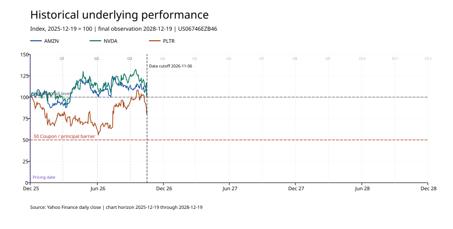

# CUHK 5690 · Barclays 自动赎回票据分析

本项目研究 Barclays Bank PLC 发行的 US06746EZB46。每张面值 1,000 美元，挂钩 AMZN、NVDA、PLTR。11 月 13 日会议版本可以离线回放已发生的观察日，也可以用指定股价路径检验合同。产品配置待成员 A 复核，概率模型与估值参数待成员 B 确定。[SEC 定价文件 PS-1–2](https://www.sec.gov/Archives/edgar/data/312070/000191870425022061/form424b2.htm)

## 在本地运行

在终端进入项目目录，激活已准备好的 Python 环境，运行以下两条命令。本次使用 Python 3.10 验证。演示读取已保存的行情快照，无需联网或行情密钥。

```bash
cd "/Users/wener/Documents/CUHK/5690-project"
python -m unittest discover -s tests -v
python -m src.demo
```

若当前环境提示缺少依赖，运行 `python -m pip install -r requirements.txt`。程序从 `data/raw/` 重建行情宽表、逐期现金流和价格图。把项目交给组员时，进入对方机器上的项目目录后运行相同的两条 Python 命令。

## 周五演示

| 打开 | 展示内容 |
| --- | --- |
| [数据质量检查](output/tables/data_quality.csv)与[价格图](output/figures/normalized_prices.svg) | 三只股票各 464 个交易日，定价日收盘价与合同初始价逐项一致。图中三条曲线均以各自定价日收盘价为 100。 |
| [合同配置](config/product_terms.yaml) | 按美元录入已舍入的障碍；12 组观察日、支付日成对保存。 |
| [历史现金流回放](output/tables/historical_replay.csv) | 至 2026-11-06，前三个观察日均满足付息条件。第 2、3 期 PLTR 低于初始价，票据继续存续。按计划日期测算累计应付 117.375 美元。 |
| [人为路径](output/tables/synthetic_memory_call.csv) | 第 1 期 PLTR 比障碍低 0.01 美元；第 2 期三股恰好回到初始价，支付本金 1,000 和两期票息 78.25 美元。 |
| [会议确认页](meeting_2026-11-13.md) | 与 A、B 确认条款与模型输入，再开始基准估值。 |



## 文件分工

- `config/` 保存合同参数和行情窗口内的交易日历；`data/raw/` 保存原始响应、精确请求链接、下载日和 SHA-256 校验值；`data/processed/` 保存收盘价、调整收盘价及公司行动。[数据字典](data/data_dictionary.md)
- `src/data_loader.py` 验证原始快照并按纽约交易日期对齐。`src/payoff.py` 把单条路径转换为逐期应付金额。`src/visualization.py` 生成可直接插入报告的 SVG。`src/demo.py` 串联复跑流程。
- `src/model.py` 和 `src/valuation.py` 记录待接入的接口口径。`tests/test_payoff.py` 用手算结果检验条款。`output/tables/` 与 `output/figures/` 保存可复现的报告素材。

## 接入成员 B 的模型

```python
from src.payoff import evaluate_note, load_terms

terms = load_terms()
paths = {
    "2026-03-19": {"AMZN": "227.35", "NVDA": "180.99", "PLTR": "96.68"},
    "2026-06-22": {"AMZN": "227.35", "NVDA": "180.99", "PLTR": "193.38"},
}
result = evaluate_note(paths=paths, terms=terms)
print(result["rows"], result["total_cashflow"])
```

每条路径给出观察日的绝对股价（美元）。完整路径可在赎回日结束；部分回放通过 `as_of="YYYY-MM-DD"` 指定最后允许观察的日期。缺少应有观察日会报错。输出按支付日列应付票息及本金，`total_cashflow` 为未折现流入总额。期末未补发且已失效的票息记录在 `expired_periods`。当前采用计划观察日和支付日，历史回放尚待与计算代理的调整及实际支付记录核对。


## 数据说明
### 1. 数据来源
- 产品合同数据 -- SEC官方定价文件  --product_terms.yaml
- 市场交易日  -- Nasdaq公布的交易安排  -- market_calendar.yaml

- 标的股票历史价格（25年至今） 
1. 数据来源 -- manifest.json  -- Yahoo Finance Chart接口 
2. 加载数据 date_loader.py
- 官方收盘价 -- prices_close.csv 
- 复权价格 -- prices_adjusted.csv (directly from Yahoo Finance)
- 公司的分红和拆股行为记录 -- corporate_actions.csv

## 关键函数说明
1. demo.py
读取数据、分别用历史数据和合成的数据模拟

2. evaluate_note(paths, terms, as_of=None) -- payoff.py
给定一条股票价格路径，根据产品条款计算逐期票息、本金和产品状态。 -- output

3. plot_prices(close, terms) -- visualization.py
将三只股票的 Close 相对于合同初始价格标准化，并生成走势图。
