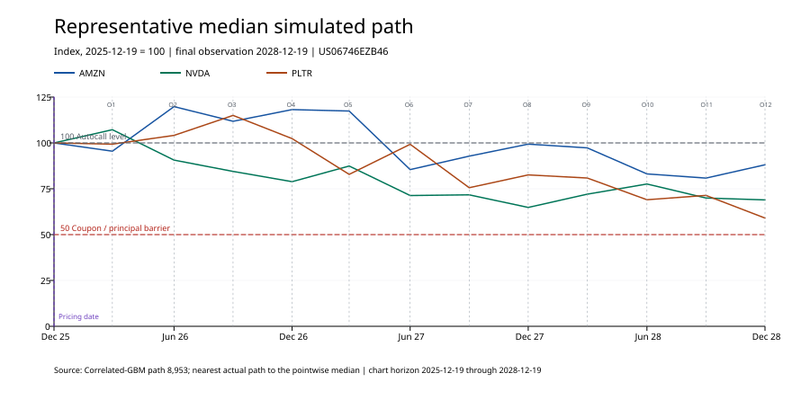

# CUHK 5690 · Barclays Worst-of Autocallable Memory Note

本项目研究 Barclays Bank PLC 发行的结构性票据 **US06746EZB46**。每份票据面值为 USD 1,000，挂钩 AMZN、NVDA 和 PLTR，包含条件票息、Memory coupon、Worst-of、Autocall 及到期本金障碍条款。

[SEC 最终定价文件](https://www.sec.gov/Archives/edgar/data/312070/000191870425022061/form424b2.htm)

当前版本已经实现：

- 合同条款配置与检查；
- 原始行情快照验证和历史价格重建；
- 已发生观察日的历史回放；
- 单条价格路径的票息、本金和产品状态计算；
- 相关 GBM 股价路径生成；
- Monte Carlo 折现估值；
- 自动赎回概率和本金损失概率统计；
- 代表性中位数路径选择；
- CSV 结果和 SVG 图形输出。

> 当前模型参数用于开发和流程验证，不是最终校准参数。最终报告使用前，需要由小组进一步确认利率、股息率、波动率、相关性、估计窗口和风险中性口径。

---

## 1. 本地运行

### 1.1 进入项目并激活环境

```bash
cd "/Users/wener/Documents/CUHK/5690-project"
source .venv/bin/activate
```

如果尚未安装依赖：

```bash
python -m pip install -r requirements.txt
```

### 1.2 运行全部测试

```bash
python -m unittest discover -s tests -v
```

当前共有14项测试，覆盖：

- Coupon barrier；
- Memory coupon累计与补发；
- Autocall及终止后的现金流；
- 到期本金保护和Worst-of损失；
- 模拟路径结构与随机种子；
- 相关矩阵验证；
- 确定性零波动率边界；
- 代表性中位数路径选择；
- 路径折现估值。

### 1.3 运行完整演示

```bash
python -m src.demo
```

必须从项目根目录使用模块方式运行。不要直接运行：

```bash
python src/demo.py
```

因为项目内部使用相对导入，直接执行文件会导致 `attempted relative import with no known parent package`。

---

## 2. 项目结构

```text
5690-project/
├── config/
│   ├── product_terms.yaml       # 合同条款
│   ├── market_calendar.yaml     # 市场交易日
│   └── model_inputs.yaml        # 当前示例模型参数
├── data/
│   ├── raw/                     # 不可变原始行情快照
│   ├── processed/               # 重建后的价格和公司行动
│   └── data_dictionary.md       # 数据字段说明
├── src/
│   ├── data_loader.py           # 数据验证与处理
│   ├── payoff.py                # 产品payoff engine
│   ├── model.py                 # 相关GBM与代表路径选择
│   ├── valuation.py             # 现金流折现与Monte Carlo汇总
│   ├── visualization.py         # SVG图形输出
│   └── demo.py                  # 完整流程入口
├── tests/
│   ├── test_payoff.py           # 产品条款测试
│   └── test_model.py            # 模型与估值测试
└── output/
    ├── tables/                  # CSV结果
    └── figures/                 # SVG图形
```

---

## 3. 数据说明

### 3.1 产品条款

- 来源：SEC 最终定价文件；
- 配置文件：`config/product_terms.yaml`；
- 包括本金、票息率、观察日、付款日、barrier、autocall和到期规则。

### 3.2 股票行情

- 标的：AMZN、NVDA、PLTR；
- 来源：Yahoo Finance Chart 接口；
- 原始响应：`data/raw/*.json`；
- 文件哈希和请求信息：`data/raw/manifest.json`；
- 官方收盘价：`data/processed/prices_close.csv`；
- 调整收盘价：`data/processed/prices_adjusted.csv`；
- 拆股和分红：`data/processed/corporate_actions.csv`。

`data_loader.py` 会检查：

- SHA-256 是否与manifest一致；
- 股票代码、货币和时区是否正确；
- 是否存在重复或缺失交易日；
- 价格是否为正且有限；
- 定价日价格是否与合同初始价格一致；
- 是否存在需要进一步处理的拆股事件。

---

## 4. 核心流程

```text
读取合同与市场数据
        ↓
验证历史行情
        ↓
生成相关GBM价格路径
        ↓
evaluate_note()计算每条路径的合同现金流
        ↓
按实际付款日期折现
        ↓
汇总Monte Carlo估值和风险概率
        ↓
选择代表性中位数路径
        ↓
输出CSV和SVG
```

---

## 5. 关键函数

### 5.1 `evaluate_note(paths, terms, as_of=None)`

文件：`src/payoff.py`

输入一条股票价格路径，根据合同条款逐期判断：

- 是否支付当期票息；
- 是否补发Memory coupon；
- 是否触发Autocall；
- 到期本金是否受保护；
- 是否按照Worst-of表现承担本金损失。

返回逐期结果、票息现金流、未付Memory coupon、自动赎回日期、本金和总现金流。

### 5.2 `simulate_paths(terms, inputs)`

文件：`src/model.py`

使用风险中性相关GBM，在12个合同观察日生成多条三股票价格路径。每条路径的格式可直接传入 `evaluate_note()`。

### 5.3 `value_paths(paths, terms, inputs)`

文件：`src/valuation.py`

逐条计算合同现金流，按实际付款日期折现，并汇总：

- 每份票据估计价值；
- Monte Carlo标准误；
- 自动赎回概率；
- 本金损失概率；
- 折现价值分位数。

### 5.4 `select_median_path(paths, terms)`

文件：`src/model.py`

程序先计算三只股票在各观察日的中位数表现，再从全部模拟结果中选择距离该中位数轨迹最近的一条**真实模拟路径**。

它不会把不同路径的中位数点拼接成一条不存在的价格路径。

### 5.5 `plot_prices()`及Monte Carlo图形

文件：`src/visualization.py`

输出标准化历史价格、单路径表现、模拟路径集合及折现payoff分布图。

---

## 6. 当前基准模型

当前版本使用相关几何布朗运动：

\[
S_i(t+\Delta t)=S_i(t)\exp\left[
\left(r-q_i-\frac{1}{2}\sigma_i^2\right)\Delta t
+\sigma_i\sqrt{\Delta t}Z_i
\right].
\]

其中不同股票的随机冲击通过相关矩阵和Cholesky decomposition生成。

当前开发参数：

| 参数 | AMZN | NVDA | PLTR |
|---|---:|---:|---:|
| 年化波动率 | 35% | 50% | 55% |
| 连续股息率 | 0.00% | 0.03% | 0.00% |

- 无风险利率：4.00%；
- 模拟路径：10,000条；
- 随机种子：5690；
- AMZN–NVDA相关系数：0.55；
- AMZN–PLTR相关系数：0.45；
- NVDA–PLTR相关系数：0.60。

这些参数保存在 `config/model_inputs.yaml`，可以由负责数学和金融分析的组员直接替换。

---

## 7. 当前示例结果

在上述开发参数下：

| 指标 | 结果 |
|---|---:|
| Monte Carlo估值 | USD 963.63 |
| 标准误 | USD 3.50 |
| 自动赎回概率 | 46.15% |
| 本金损失概率 | 25.84% |

当前代表性中位数路径为第8,953条模拟路径：

- 产品持有至到期；
- 12期票息全部支付；
- 未触发Autocall；
- 到期返还USD 1,000本金；
- 总现金流为USD 1,469.50。

修改模型参数、路径数量或随机种子后，程序会自动重新模拟并重新选择代表路径。

---

## 8. 输出文件

### 8.1 表格

- `output/tables/data_quality.csv`：行情质量检查；
- `output/tables/historical_replay.csv`：历史观察日回放；
- `output/tables/synthetic_memory_call.csv`：人工Memory/Autocall测试情景；
- `output/tables/monte_carlo_summary.csv`：Monte Carlo估值汇总；
- `output/tables/representative_median_path.csv`：代表路径逐期现金流。

### 8.2 图形

- `output/figures/normalized_prices.svg`：历史标的表现；
- `output/figures/synthetic_prices.svg`：人工测试路径；
- `output/figures/monte_carlo_paths.svg`：Monte Carlo路径集合；
- `output/figures/monte_carlo_value_distribution.svg`：折现payoff分布；
- `output/figures/representative_median_path.svg`：代表性中位数路径。



---

## 9. 当前限制与后续工作

当前模型主要用于验证代码架构和估值流程，仍需要进一步完成：

- 确定风险中性模型和最终参数来源；
- 校准波动率、股息率和相关矩阵；
- 讨论历史波动率与隐含波动率的选择；
- 讨论常数参数、波动率曲面和其他模型扩展；
- 对关键参数进行敏感性分析；
- 将模型结果与Barclays初始估计价值USD 940.80比较；
- 在最终报告中解释模型风险和参数限制。

当前模型估值不能直接视为最终公允价值或投资建议。
